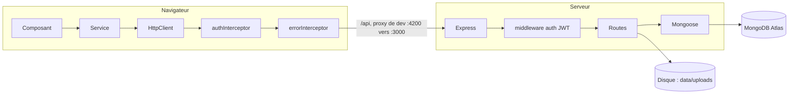

# Guitar Practice Cloud

Espace cloud d'une application de travail de la guitare dans le navigateur : comptes utilisateurs, profil et bibliothèque personnelle de fichiers audio (import, liste paginée, écoute, suppression).

Projet réalisé dans le cadre du module de développement web du M1 MIAGE (Université Côte d'Azur, SMUAGE07), enseignant M. Buffa. Les travaux pratiques 1 à 3 sont rendus dans ce dépôt, sur la branche `tp3-reliability` (tag `rendu-1-2-3`).

**Auteur :** Abdellah Jebar

## Sommaire

1. [Fonctionnalités](#fonctionnalités)
2. [Architecture](#architecture)
3. [Stack technique](#stack-technique)
4. [Démarrage rapide](#démarrage-rapide)
5. [Contrat d'API](#contrat-dapi)
6. [Sécurité](#sécurité)
7. [Tests et qualité](#tests-et-qualité)
8. [Organisation du dépôt](#organisation-du-dépôt)
9. [Historique du travail par TP](#historique-du-travail-par-tp)
10. [Choix techniques](#choix-techniques)
11. [Limites connues](#limites-connues)
12. [Dépannage](#dépannage)
13. [Documentation complémentaire](#documentation-complémentaire)

## Fonctionnalités

| Domaine | Fonctionnalités |
|---|---|
| Comptes | Inscription, connexion, déconnexion, formulaires réactifs avec validation et messages d'erreur accessibles |
| Session | JWT valable 2 h, conservé dans un Signal et dans `localStorage`, retour automatique vers `/login` sur une réponse `401` |
| Profil | Lecture et modification du nom (`/api/users/me`) |
| Bibliothèque | Liste paginée côté serveur, cards responsives et accessibles (titre, nom d'origine, format, taille, date) |
| Upload | Contrôles avant envoi (type, taille), progression en pourcentage, états `idle`, `uploading`, `success`, `error`, protection contre la double soumission |
| Lecture | Lecture authentifiée par `Blob` et `ObjectURL`, affichage du morceau en cours, erreurs audio explicites, libération de l'`ObjectURL` |
| Suppression | Confirmation, état d'attente, SnackBar, gestion d'une piste déjà supprimée ou n'appartenant pas à l'utilisateur |

## Architecture



- Angular ne dialogue jamais directement avec MongoDB.
- MongoDB conserve les utilisateurs et les métadonnées des pistes ; les octets des fichiers audio restent sur le disque du serveur.
- Un composant n'appelle jamais `HttpClient` : il passe par un service (`AuthService`, `TrackService`).
- Le guard Angular améliore l'ergonomie mais ne sécurise rien : la vérification réelle du JWT et du propriétaire de la piste est faite par le backend.

## Stack technique

| Couche | Technologies |
|---|---|
| Frontend | Angular 22 (composants standalone, Signals, Reactive Forms, `inject()`, `@if`/`@for`), Angular Material (SnackBar), RxJS |
| Backend | Node.js (ESM), Express 5, Mongoose 9, Multer 2, jsonwebtoken, bcryptjs |
| Base de données | MongoDB Atlas |
| Tests | Vitest et jsdom (frontend), `node --test` (backend) |

## Démarrage rapide

### Prérequis

- Node.js compatible avec Angular CLI 22 (au minimum 22.22.3) ;
- un compte MongoDB Atlas, voir [ATLAS_SETUP.md](ATLAS_SETUP.md) ;
- Git et un navigateur récent.

### 1. Backend

```bash
cd backend
cp .env.example .env
```

Renseigner dans `.env` :

| Variable | Rôle |
|---|---|
| `MONGODB_URI` | URI de connexion MongoDB Atlas |
| `JWT_SECRET` | Secret de signature des jetons : une longue valeur aléatoire, propre à votre machine |
| `PORT` | Port d'écoute (3000 par défaut) |

```bash
npm install
npm start
```

Vérifier : <http://localhost:3000/api/health> répond `{ "status": "ok" }`. Les journaux du backend s'affichent dans le terminal qui l'exécute.

### 2. Frontend

Dans un second terminal :

```bash
cd frontend-starter
npm install
npm start
```

Ouvrir <http://localhost:4200>. Le proxy de développement (`proxy.conf.json`) redirige `/api` vers `http://localhost:3000`.

Compte de démonstration, créé au premier démarrage du backend (usage local uniquement) : `demo@example.com` / `Demo1234!`.

### Commandes utiles

| Commande | Dossier | Effet |
|---|---|---|
| `npm start` | `backend/` | Démarre l'API avec `.env` |
| `npm test` | `backend/` | Tests backend (`node --test`) |
| `npm start` | `frontend-starter/` | Serveur de développement avec proxy |
| `npm test` | `frontend-starter/` | Tests frontend (`ng test --watch=false`) |
| `npm run build` | `frontend-starter/` | Build de production |

## Contrat d'API

Base : `/api`. Sauf `health`, l'inscription et la connexion, chaque requête porte `Authorization: Bearer <jeton>`. Détail complet : [API_CONTRACT.md](API_CONTRACT.md).

| Méthode | Route | Accès | Corps / paramètres | Réponse |
|---|---|---|---|---|
| GET | `/health` | public | | `200 { status: "ok" }` |
| POST | `/auth/register` | public | `{ name, email, password }` | `201 { token, user }` |
| POST | `/auth/login` | public | `{ email, password }` | `200 { token, user }` |
| GET | `/users/me` | JWT | | `200 User` |
| PUT | `/users/me` | JWT | `{ name }` | `200 User` |
| GET | `/tracks?page=1&limit=5` | JWT | `page`, `limit` (maximum 20) | `200 { items, page, limit, total, pages }` |
| POST | `/tracks` | JWT | multipart : `audio`, `title` | `201 Track` |
| GET | `/tracks/:id/audio` | JWT, propriétaire | | flux audio |
| DELETE | `/tracks/:id` | JWT, propriétaire | | `204` |

Codes d'erreur courants : `400` validation, `401` authentification, `404` ressource inconnue (y compris la piste d'un autre utilisateur), `409` email déjà utilisé.

Formats audio acceptés : MP3, WAV, OGG, M4A. Taille maximale : 25 Mo.

## Sécurité

| Mesure | Où |
|---|---|
| Mots de passe hachés avec bcrypt, jamais stockés en clair ni renvoyés (`select: false`, `toPublic()`) | `backend/src/models/User.js` |
| JWT signé, expiration 2 h, vérifié à chaque requête protégée | middleware `auth`, `backend/src/app.js` |
| Message d'erreur identique pour un email inconnu et un mauvais mot de passe (pas d'énumération de comptes) | route `/auth/login` |
| Filtrage par propriétaire : `ownerId` issu du jeton, jamais d'un paramètre client ; une piste d'autrui donne `404` | routes `/tracks` |
| Mise à jour du profil limitée au champ `name`, sur l'identité du jeton (`/users/me`) | route `PUT /users/me` |
| Upload : limite de 25 Mo, types MIME contrôlés, nom de stockage généré (UUID), nettoyage du fichier en cas d'échec | Multer et route `POST /tracks` |
| Jeton envoyé uniquement aux requêtes `/api/` (jamais à une autre origine) | `auth.interceptor.ts`, testé |
| Une réponse `401` hors `/api/auth/` déconnecte et renvoie vers `/login` | `error.interceptor.ts` |
| Aucun secret dans le dépôt : `.env` ignoré, seul `.env.example` est versionné ; aucun mot de passe ni jeton journalisé | `.gitignore`, journaux |
| Validation côté Angular pour l'ergonomie, revalidation systématique côté backend | formulaires et routes |

## Tests et qualité

Résultats consignés dans [docs/tp3/rapport-tests.md](docs/tp3/rapport-tests.md) :

| Suite | Résultat |
|---|---|
| Frontend (`npm test`) | 26 tests réussis (service, intercepteur, guard, page des pistes) |
| Backend (`npm test`) | 10 tests réussis (2 de santé et de schéma, 8 de contrat et de sécurité) |
| Build (`npm run build`) | réussi, bundle initial 437,8 Ko |

- Aucun test ne dépend d'un backend ni de MongoDB : `HttpTestingController` remplace le réseau côté frontend ; côté backend, les cas choisis se terminent avant tout accès à la base.
- Les tests ont été validés par **mutation manuelle** : le code a été cassé volontairement, un défaut à la fois, et le test prévu a bien échoué (tableau dans le rapport).
- Des vérifications dans un navigateur réel (Edge sans interface, vrai backend, vraie base) ont complété les tests unitaires. Elles ont révélé un défaut invisible aux tests : `HttpClient` utilise `fetch` par défaut, qui ne rapporte pas la progression d'un envoi ; `withXhr()` dans `main.ts` le corrige.
- Non couverts par des tests automatisés : la pagination avec `page` et `limit` et l'accès à la piste d'un autre utilisateur (ils exigent une base) ; ils ont été vérifiés par requêtes réelles, voir [docs/tp2/checkpoint.md](docs/tp2/checkpoint.md).

## Organisation du dépôt

```text
backend/                  API Node ESM : Express, Mongoose, Multer, JWT
  src/app.js              createApp() : middlewares, routes, gestionnaire d'erreurs
  src/server.js           connexion MongoDB, compte de démonstration, port
  src/models/             User.js, Track.js
  test/                   api.test.js, contract.test.js
frontend-starter/         Angular 22
  src/main.ts             bootstrap, routeur, HttpClient (withXhr, intercepteurs)
  src/app/routes.ts       routes (profile et tracks protégées par authGuard)
  src/app/components/     app, login-page, register-page, profile-page, tracks-page
  src/app/shared/         services, interceptors, guards, models, utils, validators
docs/                     livrables par TP (tp1, tp2, tp3)
```

Branches : `main` (code de départ fourni), `tp1-auth` (TP1), `tp2-library` (TP1 et TP2), `tp3-reliability` (TP1, TP2 et TP3, version rendue).

## Historique du travail par TP

Un commit par étape, messages en français préfixés (`feat`, `fix`, `refactor`, `test`, `docs`).

| TP | Thème | Réalisations principales | Documents |
|---|---|---|---|
| TP1 | Authentification et profil | Cartographie ; formulaires réactifs validés ; déconnexion et navigation selon l'état ; gestion du `401` ; jeton limité à `/api` ; profil chargé automatiquement et modifiable | [mission0](docs/tp1/mission0.md), [login-flow](docs/tp1/login-flow.md), [mission1](docs/tp1/mission1.md), [signal-vs-localstorage](docs/tp1/signal-vs-localstorage.md), [checkpoint](docs/tp1/checkpoint.md) |
| TP2 | Bibliothèque, upload, lecture | Pagination serveur robuste ; contrôles et états d'upload ; cards accessibles ; lecteur `Blob` et `ObjectURL` | [analyse](docs/tp2/analyse.md), [checkpoint](docs/tp2/checkpoint.md) |
| TP3 | Fiabilisation | Suppression avec confirmation ; progression d'upload ; suites de tests frontend et backend | [rapport-tests](docs/tp3/rapport-tests.md) |

Contraintes respectées : le backend n'est pas modifié pour les missions obligatoires (seule exception : tests facultatifs dans `backend/test/`) et le contrat HTTP reste inchangé.

## Choix techniques

- **Signal et `localStorage` ensemble** : le Signal rend l'interface réactive, `localStorage` conserve la session après un rechargement. `currentUser`, lui, n'est qu'un Signal et est rechargé depuis `/api/users/me`. Voir [docs/tp1/signal-vs-localstorage.md](docs/tp1/signal-vs-localstorage.md).
- **`Blob` et `ObjectURL` pour la lecture** : une URL placée directement dans `<audio src>` n'enverrait pas l'en-tête `Authorization` ; le fichier est donc récupéré via `HttpClient` (donc via l'intercepteur) puis lu localement. L'`ObjectURL` est révoquée pour libérer la mémoire.
- **Pagination côté serveur** : chaque changement de page est une requête `GET /api/tracks?page=…&limit=…` ; la bibliothèque n'est jamais chargée entièrement pour être découpée dans Angular.
- **`withXhr()`** : nécessaire pour obtenir les événements de progression d'un envoi.
- **Intercepteurs fonctionnels** : la règle est écrite une seule fois et s'applique à toutes les requêtes.

## Limites connues

- Le JWT est conservé dans `localStorage` : une faille XSS pourrait le lire. Acceptable ici (jeton de 2 h, projet pédagogique) ; un cookie `httpOnly` serait l'alternative, avec ses propres risques (CSRF).
- Pas de jeton de rafraîchissement : à l'expiration, l'utilisateur se reconnecte.
- Si `JWT_SECRET` est absent de l'environnement, le backend retombe sur un secret de développement : toujours le définir dans `backend/.env`.
- CORS ouvert à toutes les origines dans le backend fourni ; à restreindre en production.
- Les fichiers audio sont stockés sur le disque du serveur : pas adapté à un déploiement sur plusieurs instances sans stockage partagé.
- Les tests de pagination et d'accès inter-utilisateurs côté backend ne sont pas automatisés (voir plus haut).

## Dépannage

| Symptôme | Cause probable | Solution |
|---|---|---|
| « Serveur injoignable » dans l'interface | backend arrêté ou port différent | démarrer le backend ; adapter `target` dans `frontend-starter/proxy.conf.json` |
| `MONGODB_URI manque dans backend/.env` | `.env` absent ou incomplet | `cp .env.example .env` puis renseigner les variables |
| Échec de connexion MongoDB avec une URI `mongodb+srv://` | résolution DNS des enregistrements SRV bloquée par le réseau | utiliser la forme standard `mongodb://` fournie par Atlas |
| `ng` refuse de démarrer | version de Node trop ancienne | installer Node 22.22.3 ou plus récent |
| Progression d'upload bloquée à 0 % | transport `fetch` sans `withXhr()` | vérifier `provideHttpClient(withXhr(), …)` dans `main.ts` |

## Documentation complémentaire

- Sujets : [TP1](SUJET_ETUDIANT_TP1.md), [TP2](SUJET_ETUDIANT_TP2.md), [TP3](SUJET_ETUDIANT_TP3.md)
- [API_CONTRACT.md](API_CONTRACT.md) : endpoints, formats, erreurs
- [ATLAS_SETUP.md](ATLAS_SETUP.md) : création de la base MongoDB Atlas
- [RAPPORT_IA_MODELE.md](RAPPORT_IA_MODELE.md) : rapport d'usage de l'assistant IA, mission par mission, avec preuves
- [AGENTS.md](AGENTS.md) : contexte, règles et journal des missions pour les assistants IA
- [CONSEILS_POUR_UTIISER_ASSISTANT_AI.md](CONSEILS_POUR_UTIISER_ASSISTANT_AI.md) : consignes du cours
- Consignes techniques : [frontend-starter/best-practices.md](frontend-starter/best-practices.md) et [backend/best-practices.md](backend/best-practices.md)

Les fichiers audio de `frontend-starter/fichiers-audio-de-test/` sont des fixtures fournies pour les essais. Aucun fichier uploadé, dossier `node_modules`, fichier `.env` ou identifiant local n'est versionné.
